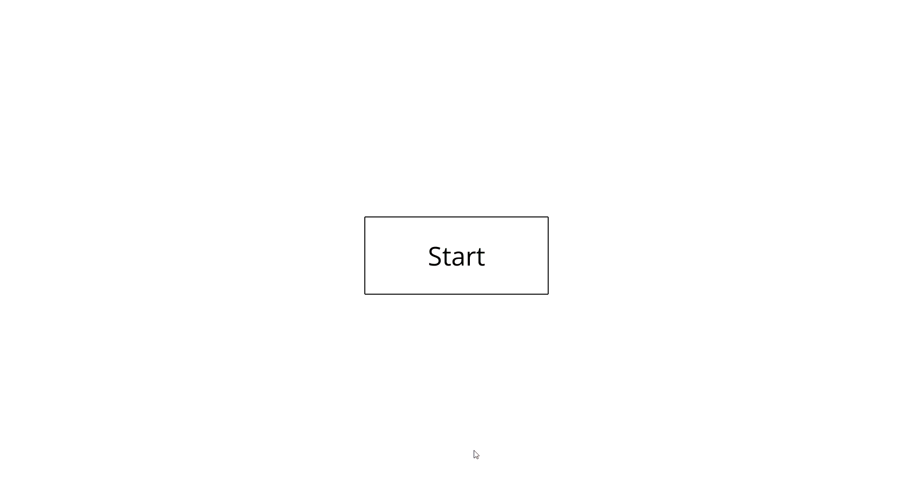

# **Complex Span Tasks**

<h2 align="center">- Rotation Span Task -</h2>

<h2 align="center">- Symmetry Span Task -</h2>

###### *All tasks are compatible with *PsychoPy version 2025.1.1**

### 🔧 **Task setup and modification instructions (coming soon)**

---
### ❝ ❞ **How to cite**

**Jaiaue, T. (2026). Complex-span-tasks. Zenodo. https://doi.org/10.5281/zenodo.23162074**

---

**Questions or bug reports?**
📧 Please contact: thipkanlayajaiaue@gmail.com
